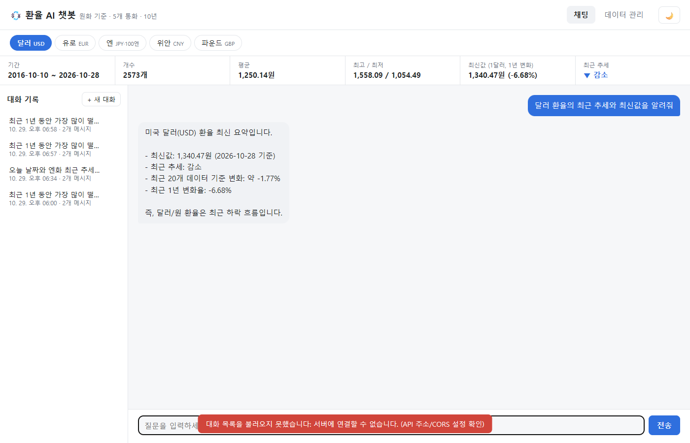
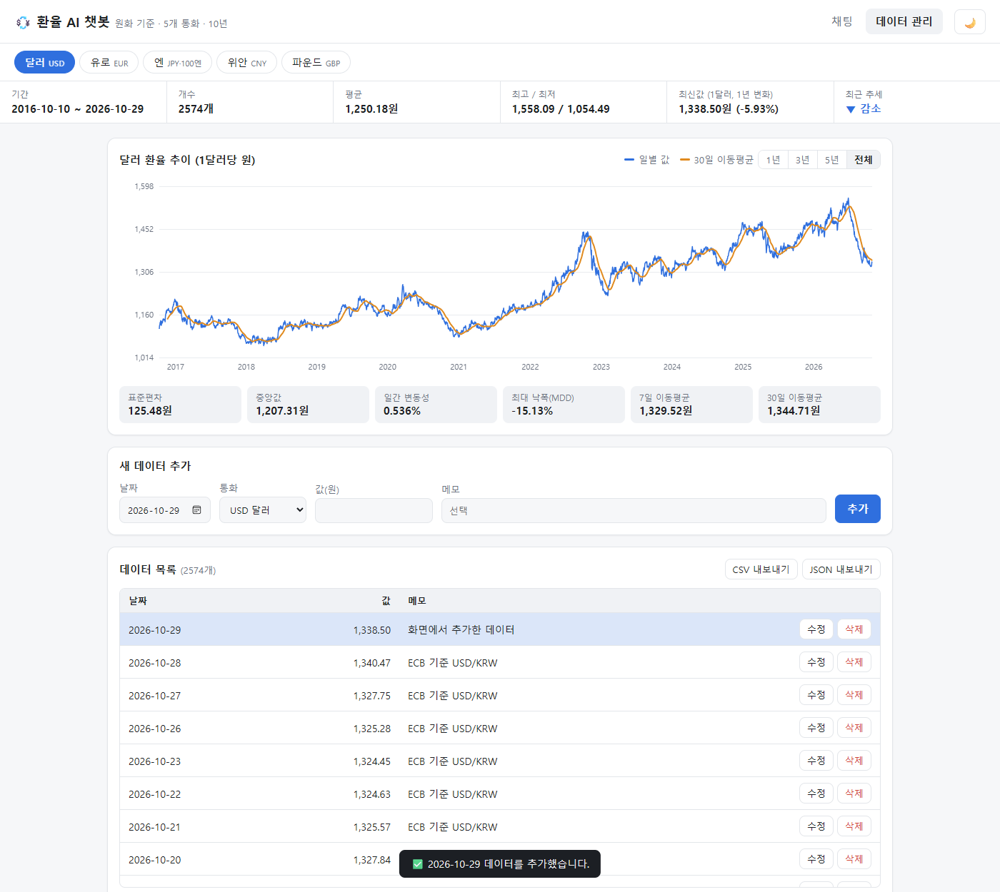
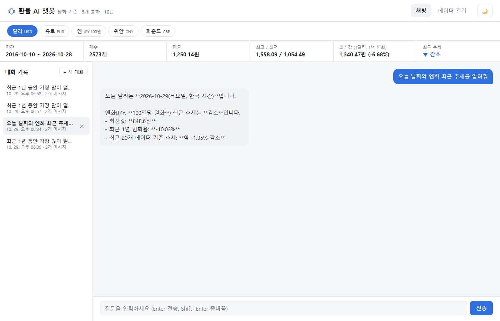

# 💱 환율 AI 챗봇 (원화 기준 5개 통화 · 10년)

달러·유로·엔·위안·파운드의 원화 환율 10년치 시계열 데이터를 저장·관리하고, **저장된 데이터의 요약을 바탕으로 답하는 AI 챗봇** 서비스입니다.

## 서비스 소개

환율이 궁금할 때 "요즘 달러가 오르고 있나?", "최근 1년 동안 가장 많이 떨어진 통화는?"을 여러 차트·표에서 직접 찾아 비교하기는 번거롭습니다.
이 서비스는 5개 통화의 10년치 일별 환율(약 1만 3천 개)을 Firestore에 저장해 두고, 질문할 때마다 **통화별 최신 데이터 요약(기간·개수·평균·최고/최저·1년 변화율·추세)을 GPT의 시스템 프롬프트에 주입**합니다.
그래서 GPT가 일반 지식이 아니라 **실제 저장된 수치**로 답합니다. 데이터를 추가·수정·삭제하면 다음 답변부터 바로 반영됩니다.

| 기능 | 설명 |
| --- | --- |
| 데이터 기반 AI 채팅 | 질문 → 요약 주입 → GPT 답변, 로딩 표시, 필요 시 도구 호출(Function Calling) |
| 데이터 관리(CRUD) | (date, currency, value, memo) 추가/수정/삭제, 목록 갱신, 저장 결과 토스트 |
| 대화 기록 | 채팅 시 자동 저장, 목록 조회, 클릭 시 불러오기, 삭제 |
| 데이터 요약 | 통화 선택 + 상단 요약 바(기간/개수/평균/최고·최저/최신값·1년 변화/추세) |
| 보너스 | Function Calling + **MCP 서버**(외부 AI 클라이언트 연동), 상세 통계 API(연도별·월별 포함), 추이 그래프(1년/3년/5년/전체 + 이동평균), CSV/JSON 내보내기, 다크 모드 |

## 배포 URL

| 구분 | URL |
| --- | --- |
| 프론트엔드 (Vercel) | `https://<your-app>.vercel.app` |
| 백엔드 API (Render) | `https://<your-api>.onrender.com` |
| Swagger UI | `https://<your-api>.onrender.com/docs` |

> ⏳ **Render 무료 플랜 안내**: 15분간 요청이 없으면 서버가 잠듭니다. 첫 접속 시 30초~1분 정도 걸릴 수 있습니다.
> 프론트엔드는 접속하자마자 `/health`로 서버를 깨우고, 2.5초 이상 걸리면 "서버를 깨우는 중" 안내 배너를 띄운 뒤 응답이 올 때까지 재시도합니다.

## 기술 스택

- **Backend**: Python 3.12, FastAPI, Uvicorn, Pydantic v2
- **DB**: Firebase Firestore (`firebase-admin`)
- **AI**: OpenAI Python SDK (`gpt-5.5`, Codyssey 프록시 `https://copa.codyssey.kr/v1`), Function Calling
- **Frontend**: HTML / CSS / JavaScript (프레임워크 없음, 그래프는 Canvas로 직접 그림)
- **배포**: Render(백엔드), Vercel(프론트엔드)

## 데이터

- **출처**: 유럽중앙은행(ECB) 기준 환율, [Frankfurter API](https://www.frankfurter.app/)
- **통화**: USD(달러), EUR(유로), JPY(엔, **100엔당**), CNY(위안), GBP(파운드) — 모두 원화(KRW) 환산 값
- **범위**: 2016-10-10 ~ 2026-10-28 영업일 기준 통화별 **2,573개 × 5 = 12,865개** (`backend/data/fx_krw.csv`, 2026-10-29 갱신)
- **갱신**: `python -m scripts.update_rates`가 마지막 날짜 이후의 환율만 받아 빠진 날짜를 채웁니다(아래 "데이터 최신화" 참고)
- **요약 정보** (`GET /api/data/summary?currency=USD`, 전체는 `/api/data/summary/all`)
  - 기간, 개수, 평균, 최고/최저(날짜 포함), 시작값/최신값, 기간 변화율, **최근 1년 변화율**
  - **최근 추세**: 최근 20개 값에 선형회귀 기울기를 구해 구간 동안의 예상 변화율이 +1% 이상이면 `증가`, -1% 이하면 `감소`, 그 사이면 `유지`
- **상세 통계** (`GET /api/data/statistics?currency=USD`, 보너스): 표준편차, 중앙값, 일간 변동성, 최대 낙폭(MDD), 7/30일 이동평균, 연도별·월별 평균/최고/최저

## 프로젝트 구조

```
Codyssey-M1-2/
├── backend/
│   ├── main.py                  # 앱 생성, CORS, 라우터 등록, 전역 예외 처리
│   ├── app/
│   │   ├── config.py            # 환경 변수 로드
│   │   ├── currencies.py        # 지원 통화 목록
│   │   ├── db.py                # Firestore 연결 + 저장소(Repo) 추상화
│   │   ├── schemas.py           # Pydantic 요청/응답 모델(검증 규칙)
│   │   ├── routers/             # HTTP 계층: 경로, 상태 코드, 에러 변환
│   │   │   ├── data.py
│   │   │   ├── conversations.py
│   │   │   └── chat.py
│   │   └── services/            # 비즈니스 로직: 분석, 저장, GPT 호출
│   │       ├── data_service.py
│   │       ├── conversation_service.py
│   │       └── chat_service.py
│   ├── scripts/
│   │   ├── seed.py              # CSV → Firestore 초기 적재
│   │   └── update_rates.py      # 최신 환율로 빠진 날짜 채우기(CSV/Firestore)
│   ├── data/fx_krw.csv          # 5개 통화 × 10년
│   ├── requirements.txt
│   └── .env.example
├── frontend/
│   ├── public/                  # index.html, style.css, app.js (+ 빌드 시 생성되는 config.js)
│   ├── build.js                 # API_BASE_URL 환경 변수 → public/config.js
│   └── vercel.json
├── mcp_server/                  # 보너스: 같은 기능을 MCP 도구로 노출
│   ├── server.py                # FastMCP 서버(stdio), 도구 6개 → 백엔드 HTTP 호출
│   ├── test_client.py           # stdio로 띄워 도구 목록·호출을 확인하는 클라이언트
│   └── requirements.txt         # mcp(1.x), httpx — 백엔드 배포에는 포함하지 않음
├── .mcp.json.example            # Claude Code 프로젝트 MCP 설정 예시
├── render.yaml                  # Render 배포 설정(Blueprint)
└── docs/screenshots/
```

**분리 기준**: `routers`는 "요청을 받고 응답을 돌려주는 일"(경로, 상태 코드, 404 변환)만, `services`는 "무엇을 계산하고 저장하는지"만 담당합니다. 그래서 채팅 서비스가 HTTP를 거치지 않고 `data_service.get_summary()`를 직접 호출해 재사용할 수 있고, Firestore 접근은 `db.py`의 Repo 한 곳에 모여 있습니다.

## API

Swagger UI(`/docs`)에서 모든 API를 직접 실행해 볼 수 있습니다.

| Method | Path | 설명 |
| --- | --- | --- |
| POST | `/api/data` | 새 데이터 추가 |
| GET | `/api/data` | 데이터 목록(날짜 오름차순, `currency`/`start`/`end` 필터) |
| PUT | `/api/data/{id}` | 데이터 수정(보낸 필드만 변경) |
| DELETE | `/api/data/{id}` | 데이터 삭제 |
| GET | `/api/data/summary?currency=USD` | 통화별 데이터 요약(프롬프트 주입용) |
| GET | `/api/data/summary/all` | 5개 통화 요약 한 번에 |
| GET | `/api/data/statistics?currency=USD` | 상세 통계 (보너스) |
| GET | `/api/data/export?format=csv\|json&currency=USD` | 내보내기, currency 생략 시 전체 (보너스) |
| POST | `/api/conversations` | 대화 저장 |
| GET | `/api/conversations` | 대화 목록 — **messages 미포함**(id, title, message_count, 시각) |
| GET | `/api/conversations/{id}` | 특정 대화의 전체 messages 조회 (방식 A) |
| DELETE | `/api/conversations/{id}` | 대화 삭제 |
| POST | `/api/chat` | AI 채팅(요약 주입 + 자동 저장) |
| GET | `/health` | 헬스 체크(콜드스타트 깨우기) |

### Firestore 컬렉션 구조

```
data/{autoId}
  date: "2026-10-09"   currency: "USD"   value: 1341.49   memo: "ECB 기준 USD/KRW"
  created_at, updated_at (ISO 문자열)

conversations/{autoId}
  title: "최근 환율 추세가 어때?"
  messages: [ { role: "user"|"assistant", content, created_at }, ... ]
  created_at, updated_at
```

### 입력 검증 (Pydantic)

잘못된 값이 DB에 들어가기 전에 FastAPI가 자동으로 **422** 응답을 돌려줍니다.

- `date`: `YYYY-MM-DD` 날짜만 허용, 미래 날짜 거부
- `currency`: `USD`/`EUR`/`JPY`/`CNY`/`GBP`만 허용
- `value`: 0보다 크고 1,000,000 미만
- `memo`: 최대 200자, 앞뒤 공백 제거
- 채팅 `message`: 1~2000자, 공백만 있는 메시지 거부
- 대화 `role`: `user` / `assistant`만 허용
- 존재하지 않는 id는 404, 수정할 필드가 없으면 400, OpenAI 장애는 502, 키 미설정은 503

## 컨텍스트 주입과 도구 호출 흐름

```
사용자 질문
   │
   ▼
POST /api/chat
   │ 1. data_service.get_all_summaries()  ← 5개 통화 요약 계산(메모리 캐시 사용)
   │ 2. 통화별 요약을 시스템 프롬프트의 [데이터 요약] 자리에 삽입
   │ 3. (이어지는 대화면) 이전 메시지 최대 10개 + 새 질문
   ▼
GPT 호출 (tools 4개 제공)
   ├─ 요약만으로 답할 수 있음 → 바로 답변
   └─ 세부 정보 필요 → tool_call ─▶ 서버가 내부 함수 실행 ─▶ 결과를 tool 메시지로 전달 ─▶ GPT 재호출 (최대 3회)
   │
   ▼
4. conversations 컬렉션에 user/assistant 메시지 자동 저장
   │
   ▼
응답: { conversation_id, reply, summaries, tool_calls }
```

### 도구(Function Calling) 목록과 호출 근거

| 도구 | 언제 호출하나 |
| --- | --- |
| `get_data_summary(currency, start_date, end_date)` | 전체가 아닌 **특정 기간**의 요약이 필요할 때 |
| `get_statistics(currency, start_date, end_date)` | 변동성, 표준편차, 이동평균, 연도별·월별 평균처럼 **요약에 없는 지표**가 필요할 때 |
| `list_data(currency, start_date, end_date, limit)` | **특정 날짜의 원본 값**이 필요할 때 |
| `list_conversations()` | 사용자가 **이전 대화**를 물을 때 |

모든 도구에는 필수 인자 `reason`이 있어, GPT가 **왜 그 도구를 호출하는지**를 한 문장으로 남깁니다. 이 값은 응답의 `tool_calls`와 서버 로그에 기록되고, 채팅 화면에서는 답변 아래 "🔧 사용한 도구"에 마우스를 올리면 보입니다.

실제 호출 예시:

| 질문 | 도구 호출 | GPT가 남긴 근거(reason) |
| --- | --- | --- |
| 최근 1년 동안 가장 많이 떨어진 통화는? | 없음 | (주입된 5개 통화 요약의 "최근 1년 변화율"로 충분 → EUR -8.77%) |
| 2020년 유로 환율 변동성을 알려줘 | `get_statistics(EUR, 2020-01-01, 2020-12-31)` | "2020년 유로 환율의 변동성(표준편차·일간 변동성·최대 낙폭 등)을 확인하려고" |

## MCP 연동 (보너스)

[MCP(Model Context Protocol)](https://modelcontextprotocol.io)는 AI 클라이언트(Claude Desktop, Claude Code, Cursor 등)에 외부 도구를 연결하는 표준 규격입니다.
웹 채팅의 GPT가 Function Calling으로 쓰는 기능을 **MCP 서버(`mcp_server/server.py`)로도 노출**해, 다른 AI 클라이언트에서도 같은 데이터를 조회할 수 있게 했습니다.

### 호출 흐름

```
[채널 1] 웹 채팅
브라우저 ──▶ POST /api/chat ──▶ GPT(gpt-5.5) ──tool_call──▶ data_service ──▶ Firestore

[채널 2] MCP
Claude 등 MCP 클라이언트 ──stdio(JSON-RPC)──▶ mcp_server/server.py ──HTTP GET──▶ FastAPI /api/... ──▶ Firestore
```

1. 클라이언트가 `server.py`를 하위 프로세스로 띄우고 stdio로 연결합니다(`initialize` → `tools/list`).
2. 사용자의 질문에 따라 **클라이언트 쪽 모델이** 도구 설명(docstring)과 입력 스키마를 보고 호출할 도구와 인자를 고릅니다(`tools/call`).
3. MCP 서버는 인자를 검증(통화는 `USD`/`EUR`/`JPY`/`CNY`/`GBP`만)하고 백엔드 API를 호출해 JSON을 돌려줍니다.
4. 백엔드 오류(404, 422)나 연결 실패·시간 초과는 읽을 수 있는 오류 메시지(`isError`)로 바꿔 전달합니다.

MCP 서버는 DB에 직접 접근하지 않고 **백엔드 API만 호출**합니다. 그래서 웹 서비스와 같은 데이터·검증 규칙을 쓰고, 키(Firebase/OpenAI)도 필요 없습니다. 조회 전용이라 데이터를 바꾸는 도구는 넣지 않았습니다.

### 도구 목록

| 도구 | 호출하는 API | 용도 |
| --- | --- | --- |
| `get_summary(currency)` | `GET /api/data/summary` | 한 통화의 요약(기간, 평균, 최고/최저, 1년 변화율, 추세) |
| `get_all_summaries()` | `GET /api/data/summary/all` | 5개 통화 요약을 한 번에 — 통화 비교 질문용 |
| `get_statistics(currency, start_date?, end_date?)` | `GET /api/data/statistics` | 변동성, MDD, 이동평균, 연도별·월별 통계(월별은 최근 24개월) |
| `list_data(currency, start_date?, end_date?, limit≤60)` | `GET /api/data` | 특정 기간의 일별 원본 값 |
| `list_conversations()` | `GET /api/conversations` | 웹 채팅에 저장된 대화 목록 |
| `get_conversation(conversation_id)` | `GET /api/conversations/{id}` | 대화 하나의 전체 메시지 |

### 설치와 실행

```bash
# 저장소 루트에서
python -m venv mcp_server/.venv
mcp_server/.venv/Scripts/pip install -r mcp_server/requirements.txt   # macOS/Linux: mcp_server/.venv/bin/pip

# 백엔드를 켠 상태에서 동작 확인 (도구 목록 + 실제 호출)
mcp_server/.venv/Scripts/python mcp_server/test_client.py
```

백엔드 주소는 환경 변수 `API_BASE_URL`(기본 `http://localhost:8000`)로 바꿉니다. 배포 후에는 Render 주소를 넣으면 됩니다.

### 클라이언트에 연결하기

**Claude Code** — 둘 중 하나:

```bash
# 명령으로 추가 (저장소 루트에서, Windows 경로 예시)
claude mcp add fx-ai-chat --env API_BASE_URL=http://localhost:8000 -- mcp_server/.venv/Scripts/python mcp_server/server.py
```

또는 `.mcp.json.example`을 `.mcp.json`으로 복사하면 이 저장소를 연 Claude Code가 프로젝트 MCP 서버로 인식합니다(처음 한 번 사용 승인).

**Claude Desktop** — `claude_desktop_config.json`의 `mcpServers`에 추가(경로는 절대 경로로):

```json
{
  "mcpServers": {
    "fx-ai-chat": {
      "command": "C:/path/to/Codyssey-M1-2/mcp_server/.venv/Scripts/python.exe",
      "args": ["C:/path/to/Codyssey-M1-2/mcp_server/server.py"],
      "env": { "API_BASE_URL": "https://<your-api>.onrender.com", "PYTHONIOENCODING": "utf-8" }
    }
  }
}
```

### 실제 호출 결과 (`test_client.py`, 로컬 백엔드, 2026-10-29)

| 호출 | 결과 요약 |
| --- | --- |
| `tools/list` | 도구 6개 확인 (위 표와 동일) |
| `get_all_summaries()` | 5개 통화 요약. 예: USD 2,573개, 2016-10-10 ~ 2026-10-28, 최신 1,340.47원, 1년 -6.68%, 추세 감소 |
| `get_summary(JPY)` | 100엔당 최신 848.6원, 10년 최고 1,173.76원(2020-03-09), 최저 839.62원(2026-10-21), 1년 -10.03% |
| `get_statistics(EUR, 2020-01-01, 2020-12-31)` | 257개, 표준편차 33.8원, 일간 변동성 0.551%, MDD -7.72%, 연평균 1,345.58원 |
| `list_data(USD, start_date=2026-10-20, limit=5)` | 10-22 1,324.63원 … 10-28 1,340.47원 (주말 제외 5개) |
| `list_conversations()` → `get_conversation(id)` | 웹 채팅에 저장된 "엔화 최근 추세" 대화와 메시지 2개 조회 |
| `get_summary(KRW)` | 오류: 통화는 `USD`/`EUR`/`JPY`/`CNY`/`GBP`만 허용 (입력 검증) |
| `get_conversation("../data/summary")` | 오류: 404 — id를 URL 인코딩해 다른 API 경로로 새지 않음 |

웹 채팅(GPT)은 "어떤 도구를 왜 불렀는지"를 `reason` 인자로 남기지만, MCP에서는 도구를 고르는 주체가 클라이언트 쪽 모델이라 근거는 클라이언트 화면(도구 호출 표시)에서 확인합니다.

## 로컬 실행 방법

### 1) 백엔드

```bash
cd backend
python -m venv .venv
# Windows
.venv\Scripts\activate
# macOS/Linux
source .venv/bin/activate

pip install -r requirements.txt
cp .env.example .env        # 값 채우기 (아래 환경 변수 참고)

python -m scripts.seed      # 최초 1회: CSV 전체(12,865개)를 Firestore에 적재
uvicorn main:app --reload   # http://localhost:8000/docs
```

> Firebase 자격 증명이 없으면 서버는 **메모리 저장소 + CSV 샘플**로 뜹니다(개발용, 재시작하면 초기화). `GET /` 응답의 `storage` 값으로 `firestore`/`memory`를 확인할 수 있습니다.

### 2) 프론트엔드

```bash
cd frontend
node build.js                          # public/config.js 생성 (기본 http://localhost:8000)
python -m http.server 5500 -d public   # http://localhost:5500
```

다른 API 주소를 쓰려면 `API_BASE_URL=https://... node build.js`로 빌드합니다.

### 3) 데이터 최신화

CSV와 Firestore는 자동으로 갱신되지 않습니다. 아래 스크립트가 통화별 마지막 날짜 다음 날부터 오늘까지의 환율을 Frankfurter에서 받아 **빠진 (날짜, 통화)만** 추가합니다. 이미 최신이면 아무것도 하지 않습니다.

```bash
cd backend
python -m scripts.update_rates              # data/fx_krw.csv 갱신 (기본)
python -m scripts.update_rates --firestore  # Firestore에 빠진 날짜만 추가 (자격 증명 필요)
```

> `--firestore`는 중복 확인을 위해 data 컬렉션 전체를 한 번 읽습니다(읽기 약 1.3만 회). 실행 후 백엔드 서버를 재시작해야 메모리 캐시에 반영됩니다.

## 환경 변수

### 백엔드 (Render)

| 이름 | 필수 | 설명 |
| --- | --- | --- |
| `OPENAI_API_KEY` | ✅ | OpenAI(또는 Codyssey 프록시) API 키 |
| `OPENAI_BASE_URL` | | OpenAI 호환 프록시 주소. 예: `https://copa.codyssey.kr/v1` |
| `OPENAI_MODEL` | | 기본 `gpt-5.5` (프록시에서 쓸 수 있는 GPT 중 최신) |
| `OPENAI_MAX_TOKENS` | | 응답 최대 토큰(비용 제한), 기본 `2000` |
| `FIREBASE_SERVICE_ACCOUNT_JSON` | ✅* | 서비스 계정 키 JSON **전체 내용**(배포용) |
| `FIREBASE_SERVICE_ACCOUNT_PATH` | ✅* | 서비스 계정 키 파일 경로(로컬용) |
| `ALLOWED_ORIGINS` | ✅ | CORS 허용 도메인, 쉼표 구분. 예: `https://<your-app>.vercel.app,http://localhost:5500` |

\* 둘 중 하나만 있으면 됩니다.

### 프론트엔드 (Vercel)

| 이름 | 필수 | 설명 |
| --- | --- | --- |
| `API_BASE_URL` | ✅ | 백엔드 주소. 예: `https://<your-api>.onrender.com` |

### 키 관리와 CORS를 이렇게 한 이유

- **키는 환경 변수로만**: `.env`와 서비스 계정 JSON은 `.gitignore`에 들어 있어 GitHub에 올라가지 않습니다. 코드가 공개돼도 키가 새지 않고, 키를 바꿀 때 코드를 고칠 필요가 없습니다.
- **OpenAI 키는 백엔드에만**: 프론트엔드 JS는 누구나 볼 수 있으므로 키를 두면 바로 유출됩니다. 프론트는 백엔드 주소(`API_BASE_URL`)만 압니다.
- **CORS**: 브라우저는 다른 도메인(Vercel → Render)으로의 요청을 기본적으로 막습니다. `ALLOWED_ORIGINS`에 등록한 내 프론트 도메인만 허용해, 다른 사이트가 내 API를 브라우저에서 호출해 OpenAI 비용을 쓰는 것을 줄입니다.
- **비용 제한**: `max_completion_tokens`, 이전 대화 최대 10개, 도구 호출 최대 3회, 메시지 2000자 제한을 둡니다.
- **Firestore 읽기 한도**: 무료 플랜은 하루 읽기 5만 회입니다. 1만 2천여 건을 요청마다 읽으면 질문 4번이면 한도를 넘기 때문에, 서버가 처음 한 번만 전체를 읽어 **메모리에 캐시**하고 추가/수정/삭제 때 캐시를 함께 갱신합니다. 초기 적재(`seed`)도 쓰기 약 1.3만 회라 하루 2만 회 한도 안에서 한 번만 실행하세요.

## 배포

### 백엔드 — Render

1. 이 저장소를 GitHub에 푸시합니다.
2. Render → **New → Web Service** → 저장소 선택
   - Root Directory: `backend`
   - Build Command: `pip install -r requirements.txt`
   - Start Command: `uvicorn main:app --host 0.0.0.0 --port $PORT`
   - (또는 **New → Blueprint**로 `render.yaml` 사용)
3. Environment에 위 백엔드 환경 변수를 입력합니다. `FIREBASE_SERVICE_ACCOUNT_JSON`에는 키 파일 내용을 그대로 붙여 넣습니다.
4. 배포 후 `https://<your-api>.onrender.com/docs`에서 Swagger UI를 확인합니다.

### 프론트엔드 — Vercel

1. Vercel → **Add New Project** → 같은 저장소 선택
2. Root Directory: `frontend` (Build Command/Output은 `vercel.json`에 지정됨)
3. Environment Variables에 `API_BASE_URL=https://<your-api>.onrender.com` 추가 후 배포
4. 발급된 Vercel 도메인을 Render의 `ALLOWED_ORIGINS`에 추가합니다.

## 제출 스크린샷

| 화면 | 이미지 |
| --- | --- |
| 데이터 요약이 보이는 채팅 화면 (질문 + 답변) |  |
| 데이터 관리 화면 (추가/수정/삭제 결과) |  |
| 대화 기록 화면 (불러오기) |  |
